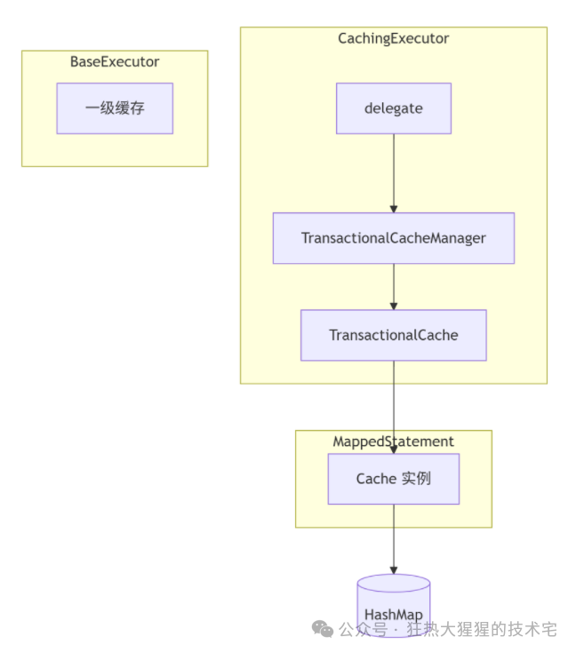

# MyBatis 源码深度拆解（八）：二级缓存机制详解

> 原作者：狂热大猩猩的技术宅 · 2026年7月27日 19:54
> [阅读微信原文](https://mp.weixin.qq.com/s?__biz=MzkzNDY5MjY1Ng==&mid=2247484057&idx=1&sn=6a1425b89e56f10244a4174f7bdf5f41&chksm=c2b810c6f5cf99d03ed7738fa8a3a7434d90989cb10fc14989133205aa5dfe524de9278183af)
> 原文排版恢复版：保留原作者内容与顺序，仅整理网页显示格式。

面试官：MyBatis 的二级缓存是什么级别的？如何开启？它与一级缓存有什么区别？为什么二级缓存需要事务提交后才生效？

<h2><strong>一、开篇</strong></h2>

二级缓存是 MyBatis 中<strong>跨 SqlSession 共享</strong>的缓存机制，作用范围是<strong>Mapper 的 namespace</strong>（即一个 Mapper 接口或 XML 文件中的所有 SQL 共享同一个二级缓存）。默认关闭，需要手动配置开启。

<strong>本篇目标</strong>：

<ul><li>二级缓存的开启与配置方式</li><li>理解<code>CachingExecutor</code>与<code>TransactionalCache</code>的协作</li><li>缓存的延迟提交机制（事务提交后才真正写入）</li><li>一级缓存与二级缓存的执行顺序</li><li>缓存刷新（flush）的时机与作用</li></ul>

<h2><strong>二、二级缓存整体架构</strong></h2>

<strong>核心组件</strong>：

<ul><li><code>CachingExecutor</code>：装饰器，为普通 Executor 添加二级缓存能力。</li><li><code>TransactionalCacheManager</code>：管理每个<code>Cache</code>对应的<code>TransactionalCache</code>。</li><li><code>TransactionalCache</code>：事务性缓存包装器，存储当前事务中待提交的缓存条目。</li><li><code>Cache</code>（通常是 <code>PerpetualCache</code>）：真正的缓存存储，本质是 <code>HashMap</code>。</li></ul>

<h2><strong>三、二级缓存的开启与配置</strong></h2>

<h3><strong>3.1 全局开关</strong></h3>

在 <code>mybatis-config.xml</code> 中：

<ul><li></li><li></li><li></li><li></li></ul>

<pre><code class="language-xml">&lt;settings&gt;
    &lt;!-- 默认 true，若设为 false，所有二级缓存失效 --&gt;
    &lt;setting name="cacheEnabled" value="true"/&gt;
&lt;/settings&gt;</code></pre>

<h3><strong>3.2 Mapper 级别开启</strong></h3>

在 Mapper XML 文件中添加 <code>&lt;cache&gt;</code> 标签：

<ul><li></li><li></li><li></li><li></li><li></li><li></li><li></li></ul>

<pre><code class="language-xml">&lt;mapper namespace="com.example.mapper.UserMapper"&gt;
    &lt;!-- 开启二级缓存 --&gt;
    &lt;cache/&gt;
    &lt;select id="selectById" resultType="User"&gt;
        SELECT * FROM user WHERE id = #{id}
    &lt;/select&gt;
&lt;/mapper&gt;</code></pre>

或者使用注解 <code>@CacheNamespace</code>

<strong>注意</strong>：<code>cacheEnabled</code> 是二级缓存的全局总开关，默认为 <code>true</code>。这意味着<strong>二级缓存在全局是‘可用’的</strong>，但还需要在具体的 Mapper XML 文件中添加 <code>&lt;cache/&gt;</code> 标签才能<strong>启用</strong>。因此，‘二级缓存默认是关闭的’这句话，是从<strong>需要手动在 Mapper 中配置</strong>这个角度来说的

<h3><strong>3.3 单个 SQL 的二级缓存控制</strong></h3>

<ul><li><code>useCache</code>：默认<code>true</code>，设为<code>false</code>时该查询不使用二级缓存。</li><li><code>flushCache</code>：对于 <code>&lt;select&gt;</code> 默认 <code>false</code>，对于 <code>&lt;insert/update/delete&gt;</code> 默认 <code>true</code>。</li></ul>

<ul><li></li><li></li><li></li></ul>

<pre><code class="language-bash">&lt;select id="selectUser" resultType="User" useCache="true" flushCache="false"&gt;
    SELECT * FROM user WHERE id = #{id}
&lt;/select&gt;</code></pre>

当<code>flushCache=true</code>时，在执行该 SQL<strong>之前</strong>，会清空对应的缓存区域：

<ul><li><strong>对于 </strong><code><strong>INSERT</strong></code><strong> / </strong><code><strong>UPDATE</strong></code><strong> / </strong><code><strong>DELETE</strong></code>：清空当前 namespace 的二级缓存。一级缓存不受影响，它会在同一个 SqlSession 的事务<strong>提交（commit）后</strong>被清空</li><li><strong>对于 </strong><code><strong>SELECT</strong></code>：清空当前 namespace 的<strong>二级缓存</strong>（但通常查询不需要清空缓存，默认 false）。一级缓存不受影响。</li></ul>

<h2><strong>四、</strong><code><strong>CachingExecutor</strong></code><strong>源码分析</strong></h2>

<code>CachingExecutor</code> 是二级缓存的核心入口，它装饰真正的执行器（如 <code>SimpleExecutor</code>）。

<h3><strong>4.1 装饰器构造</strong></h3>

<ul><li></li><li></li><li></li><li></li><li></li><li></li><li></li><li></li><li></li><li></li></ul>

<pre><code class="language-cs">// CachingExecutor
public class CachingExecutor implements Executor {
    private final Executor delegate;
    private final TransactionalCacheManager tcm = new TransactionalCacheManager();

    public CachingExecutor(Executor delegate) {
        this.delegate = delegate;
        delegate.setExecutorWrapper(this);
    }
}</code></pre>

<h3><strong>4.2</strong><code><strong>query</strong></code><strong>方法</strong></h3>

<ul><li></li><li></li><li></li><li></li><li></li><li></li><li></li><li></li><li></li><li></li><li></li><li></li><li></li><li></li><li></li><li></li><li></li><li></li><li></li></ul>

<pre><code class="language-java">@Override
public &lt;E&gt; List&lt;E&gt; query(MappedStatement ms, Object parameterObject, RowBounds rowBounds,
                         ResultHandler resultHandler, CacheKey key, BoundSql boundSql) throws SQLException {
    Cache cache = ms.getCache();                     // 获取 Mapper 关联的 Cache
    if (cache != null) {
        flushCacheIfRequired(ms);                    // 若需要清空缓存，则清空
        if (ms.isUseCache() &amp;&amp; resultHandler == null) {
            ensureNoOutParams(ms, boundSql);         // 存储过程 OUT 参数不支持二级缓存
            @SuppressWarnings("unchecked")
            List&lt;E&gt; list = (List&lt;E&gt;) tcm.getObject(cache, key);
            if (list == null) {
                list = delegate.query(ms, parameterObject, rowBounds, resultHandler, key, boundSql);
                tcm.putObject(cache, key, list);     // 存入事务缓存
            }
            return list;
        }
    }
    return delegate.query(ms, parameterObject, rowBounds, resultHandler, key, boundSql);
}</code></pre>

<strong>流程</strong>：

<ol><li>检查当前<code>MappedStatement</code>是否配置了二级缓存（<code>ms.getCache()</code>）。</li><li>执行<code>flushCacheIfRequired</code>：如果该查询标签设置了<code>flushCache=true</code>，清空整个二级缓存。</li><li>如果<code>useCache=true</code>且没有使用<code>ResultHandler</code>，且不是存储过程带 OUT 参数，则进入二级缓存逻辑。</li><li>从<code>TransactionalCacheManager</code>中尝试获取缓存结果。</li><li>若未命中，调用<code>delegate.query</code>（进入一级缓存 + 数据库查询），然后将结果存入<code>TransactionalCache</code>。</li><li>若未配置二级缓存或不满足条件，直接委托给<code>delegate.query</code>。</li></ol>

<h3><strong>4.3 </strong><code><strong>update</strong></code><strong> 方法</strong></h3>

<ul><li></li><li></li><li></li><li></li><li></li></ul>

<pre><code class="language-java">@Override
public int update(MappedStatement ms, Object parameterObject) throws SQLException {
    flushCacheIfRequired(ms);
    return delegate.update(ms, parameterObject);
}</code></pre>

更新操作会调用<code>flushCacheIfRequired</code>，根据<code>flushCache</code>配置（默认<code>true</code>）决定是否清空二级缓存。

<h3><strong>4.4 </strong><code><strong>commit</strong></code><strong> 和 </strong><code><strong>rollback</strong></code><strong> 方法</strong></h3>

<ul><li></li><li></li><li></li><li></li><li></li><li></li><li></li><li></li><li></li><li></li><li></li><li></li><li></li><li></li><li></li></ul>

<pre><code class="language-cs">@Override
public void commit(boolean required) throws SQLException {
    delegate.commit(required);
    tcm.commit();                   // 提交所有暂存的缓存项
}
@Override
public void rollback(boolean required) throws SQLException {
    try {
        delegate.rollback(required);
    } finally {
        if (required) {
            tcm.rollback();         // 回滚时丢弃暂存的缓存项
        }
    }
}</code></pre>

<strong>关键</strong>：二级缓存并非立即写入，而是等到事务提交时才真正刷新。这保证了缓存与事务的一致性。

<h2>五、TransactionalCacheManager与TransactionalCache</h2>

<h3><strong>5.1 </strong><code><strong>TransactionalCacheManager</strong></code></h3>

<ul><li></li><li></li><li></li><li></li><li></li><li></li><li></li><li></li><li></li><li></li><li></li><li></li><li></li><li></li><li></li><li></li><li></li><li></li><li></li><li></li><li></li><li></li><li></li></ul>

<pre><code class="language-typescript">public class TransactionalCacheManager {
    private final Map&lt;Cache, TransactionalCache&gt; transactionalCaches = new HashMap&lt;&gt;();

    public void putObject(Cache cache, CacheKey key, Object value) {
        getTransactionalCache(cache).putObject(key, value);
    }

    public Object getObject(Cache cache, CacheKey key) {
        return getTransactionalCache(cache).getObject(key);
    }

    public void commit() {
        for (TransactionalCache txCache : transactionalCaches.values()) {
            txCache.commit();
        }
    }

    public void rollback() {
        for (TransactionalCache txCache : transactionalCaches.values()) {
            txCache.rollback();
        }
    }
}</code></pre>

<h3><strong>5.2</strong><code><strong>TransactionalCache</strong></code><strong>核心逻辑</strong></h3>

<ul><li></li><li></li><li></li><li></li><li></li><li></li><li></li><li></li><li></li><li></li><li></li><li></li><li></li><li></li><li></li><li></li><li></li><li></li><li></li><li></li><li></li><li></li><li></li><li></li><li></li><li></li><li></li><li></li><li></li><li></li><li></li><li></li><li></li><li></li><li></li><li></li><li></li><li></li><li></li><li></li><li></li><li></li><li></li><li></li><li></li><li></li><li></li><li></li><li></li><li></li><li></li><li></li><li></li></ul>

<pre><code class="language-typescript">public class TransactionalCache implements Cache {
    private final Cache delegate;                       // 真正的缓存对象（如 PerpetualCache）
    private final Map&lt;Object, Object&gt; entriesToAddOnCommit;   // 待提交的缓存条目
    private final Set&lt;Object&gt; entriesMissedInCache;           // 本次事务中未命中缓存的 key
    private boolean clearOnCommit;                            // 提交时是否清空缓存

    @Override
    public void putObject(Object key, Object value) {
        // 暂存到待提交列表，不立即写入 delegate
        entriesToAddOnCommit.put(key, value);
    }

    @Override
    public Object getObject(Object key) {
        // 先从 delegate 中获取
        Object object = delegate.getObject(key);
        if (object == null) {
            entriesMissedInCache.add(key);
        }
        return object;
    }

    public void commit() {
        if (clearOnCommit) {
            delegate.clear();
        }
        // 将暂存的所有条目刷新到真正的缓存中
        flushPendingEntries();
        reset();
    }

    public void rollback() {
        unlockMissedEntries();
        // 回滚：丢弃待提交的条目，不清空 delegate 中已有的缓存
        reset();
    }

    private void flushPendingEntries() {
        for (Map.Entry&lt;Object, Object&gt; entry : entriesToAddOnCommit.entrySet()) {
            delegate.putObject(entry.getKey(), entry.getValue());
        }
    }
    private void unlockMissedEntries() {
        for (Object key : entriesMissedInCache) {
            try {
                delegate.getObject(key);   // 触发缓存实体的解锁（如果底层缓存实现了锁机制）
            } catch (Exception e) {
                // ignore
            }
        }
        entriesMissedInCache.clear();
    }
}</code></pre>

<strong>延迟提交机制</strong>：

<ul><li>事务内查询的结果先存入<code>entriesToAddOnCommit</code>，不写入<code>delegate</code>。</li><li>事务提交时（<code>commit()</code>），将所有暂存条目真正写入底层缓存。</li><li>事务回滚时，直接丢弃暂存条目。</li><li>如果事务中执行了更新且配置了<code>flushCache=true</code>，会标记<code>clearOnCommit</code>，提交时清空整个缓存。</li></ul>

这样设计保证了<strong>缓存与数据库事务的隔离性</strong>：一个事务中查询的数据不会被其他事务看到，直到该事务提交。

<h2><strong>六、二级缓存与一级缓存的执行顺序</strong></h2>

一次带二级缓存的查询完整调用链：

<ul><li></li><li></li><li></li><li></li><li></li><li></li><li></li><li></li><li></li><li></li><li></li><li></li><li></li><li></li><li></li><li></li><li></li></ul>

<pre><code class="language-cs">CachingExecutor.query
    ↓
检查二级缓存（ms.getCache()）
    ↓
从 TransactionalCache 获取结果
    ↓ 未命中
delegate.query（即 BaseExecutor.query）
    ↓
一级缓存 localCache.getObject(key)
    ↓ 未命中
数据库查询 → 写入一级缓存
    ↓
返回结果给 CachingExecutor
    ↓
tcm.putObject(cache, key, list) → 存入事务缓存
    ↓
事务提交时，tcm.commit() → 刷新到真正的二级缓存</code></pre>

<strong>顺序总结</strong>：一次带二级缓存的查询完整调用链的最终顺序是：<strong>一级缓存 → 二级缓存 → 数据库</strong>。原因是：CachingExecutor 在逻辑上先处理二级缓存，但实际查询时会委托给 BaseExecutor，后者会优先检查一级缓存。

<h2><strong>七、缓存清空（Flush）机制</strong></h2>

<h3><strong>7.1 清空时机</strong></h3>

<ul><li>执行<code>INSERT/UPDATE/DELETE</code>且该标签的<code>flushCache</code>属性为<code>true</code>（默认<code>true</code>）。</li><li>执行<code>&lt;select flushCache="true"&gt;</code>的查询。</li><li>手动调用<code>sqlSession.clearCache()</code>（仅清空一级缓存，不清二级）。</li><li>二级缓存可设置<code>flushInterval</code>，定时清空。</li><li>缓存回收策略（如<code>LRU</code>）达到容量上限时清除。</li></ul>

<h3><strong>7.2 源码中的清空流程</strong></h3>

<code>CachingExecutor.flushCacheIfRequired</code> 方法：

<ul><li></li><li></li><li></li><li></li><li></li><li></li></ul>

<pre><code class="language-typescript">private void flushCacheIfRequired(MappedStatement ms) {
    Cache cache = ms.getCache();
    if (cache != null &amp;&amp; ms.isFlushCacheRequired()) {
        tcm.clear(cache);
    }
}</code></pre>

<code>TransactionalCacheManager.clear</code>→<code>TransactionalCache.clear</code>：

<ul><li></li><li></li><li></li><li></li></ul>

<pre><code class="language-cs">public void clear() {
    clearOnCommit = true;
    entriesToAddOnCommit.clear();
}</code></pre>

提交时，若 <code>clearOnCommit</code> 为 <code>true</code>，会先执行 <code>delegate.clear()</code>，清空整个缓存。 

<h2><strong>八、面试高频题</strong></h2>

<h3>Q1：二级缓存是 Mapper 级别还是 namespace 级别？</h3>

<strong>A</strong>：每个 Mapper XML 文件（或注解的<code>@CacheNamespace</code>）对应一个独立的<code>Cache</code>实例，同一个 namespace 下的所有 SQL 共享该缓存。如果多个 Mapper 共享同一个 namespace（如通过<code>cache-ref</code>），则它们共用同一个缓存。

<h3>Q2：为什么二级缓存需要事务提交后才写入？</h3>

<strong>A</strong>：为了防止脏读。如果事务内查询的数据立即写入缓存，其他事务就能读到这些未提交的数据，违反了事务隔离性。通过<code>TransactionalCache</code>延迟提交机制，只有当事务提交成功后才将缓存可见，如果事务回滚，这些缓存条目会被丢弃，避免了脏数据传播。

<h3>Q3：二级缓存能否跨不同的 SqlSession 共享数据？</h3>

<strong>A</strong>：可以。二级缓存的<code>Cache</code>实例是 Mapper namespace 级别的，所有<code>SqlSession</code>共享同一个<code>Cache</code>对象。只要事务提交后，缓存数据就会被其他<code>SqlSession</code>读到。

<h3>Q4：什么时候不应该使用二级缓存？</h3>

<strong>A</strong>：

<ul><li>数据更新频繁的 Mapper，缓存经常被清空，收益不大。</li><li>查询结果涉及多个 Mapper 关联的数据，若其中一个 Mapper 更新了数据，其他 Mapper 的缓存可能无法感知（可通过<code>cache-ref</code>共享缓存来缓解，但复杂场景仍然容易产生脏数据）。</li><li>对实时性要求极高的场景（缓存延迟导致读到旧数据）。</li></ul>

<h3>Q5：如何清空二级缓存？</h3>

<strong>A</strong>：

<ul><li>执行任意<code>INSERT/UPDATE/DELETE</code>（默认<code>flushCache=true</code>）会清空对应 namespace 的二级缓存。</li><li>通过配置<code>&lt;select flushCache="true"&gt;</code>。</li><li>通过<code>&lt;cache flushInterval="60000"/&gt;</code>定时刷新。</li><li>手动调用<code>Cache</code>的<code>clear()</code>方法（可通过插件或代码获取<code>Configuration</code>中的<code>Cache</code>实例）。</li></ul>

<h3>Q6：一级缓存和二级缓存有什么区别？</h3>

<table><tbody><tr><td>
维度
</td><td>
一级缓存
</td><td>
二级缓存
</td></tr><tr><td>
作用范围
</td><td>
<code>SqlSession</code>

级别
</td><td>
Mapper namespace 级别
</td></tr><tr><td>
默认状态
</td><td>
开启
</td><td>
关闭
</td></tr><tr><td>
生命周期
</td><td>
<code>SqlSession</code>

打开到关闭
</td><td>
全局，除非主动清空或超时
</td></tr><tr><td>
是否跨会话
</td><td>
否
</td><td>
是
</td></tr><tr><td>
实现类
</td><td>
<code>PerpetualCache</code>
</td><td>
<code>PerpetualCache</code>

（通过<code>TransactionalCache</code>

包装）
</td></tr><tr><td>
事务提交影响
</td><td>
无特殊处理
</td><td>
延迟提交
</td></tr></tbody></table>

<h2><strong>九、下篇预告</strong></h2>

第 9 篇我们将深入<strong>MyBatis 插件（Interceptor）底层原理</strong>，包括：

<ul><li>责任链模式 + 装饰器模式的源码实现</li><li>四大拦截点：<code>Executor</code>、<code>StatementHandler</code>、<code>ParameterHandler</code>、<code>ResultSetHandler</code></li><li>自定义分页插件的实现原理</li></ul>

如果觉得有帮助，欢迎<strong>点赞、在看、转发</strong>支持！

系列持续更新，关注不走丢 👇

<h3> </h3>

